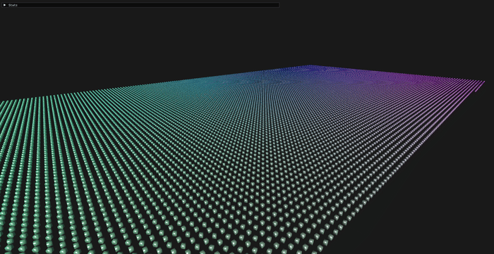
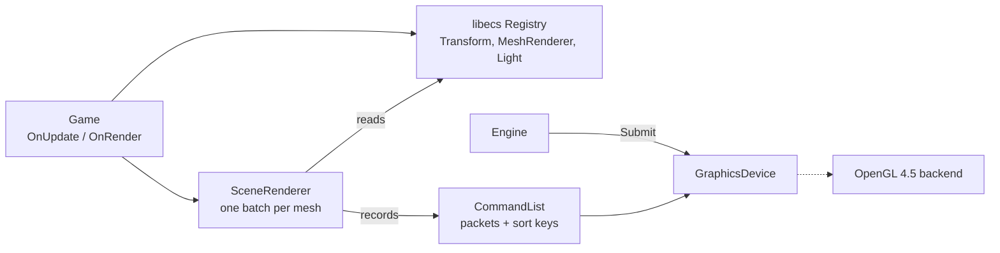

# GEF (Game Engine Foundations)

[](https://github.com/Samshiba/game-engine-foundations/actions/workflows/ci.yml)


[](LICENSE)

A small 3D rendering engine in C++20, on OpenGL 4.5.

The game describes its world with an ECS ([libecs](https://github.com/Samshiba/libecs), which I
also wrote). Each frame, the engine turns the entities into draw commands, records them in a
command list, sorts them to avoid redundant state changes, then replays them on the GPU. The
demo draws up to 50,000 lit, animated objects in a single draw call.

I am building GEF to understand how a renderer is put together, from GPU resource ownership to
batching, and to measure each choice instead of guessing.



## Highlights

- **Recorded and sorted draws**: draws are recorded as self-contained packets with a 64-bit sort
  key, then replayed through a cache that skips binds that would change nothing. 10,000 draws
  cost one pipeline bind, one vertex array bind and two uniform buffer binds.
- **GPU resources behind handles**: the graphics device owns every buffer, shader and pipeline.
  The game holds small handles that carry a generation number, so using a destroyed resource is
  detected instead of silently hitting another one.
- **No base class to inherit**: your `main` owns the engine and the game. A game is any type
  with `OnUpdate` and `OnRender` (checked by a C++20 concept), and it only receives the services
  it is allowed to use.
- **ECS-driven rendering**: `Transform`, `MeshRenderer` and light components. All entities
  sharing a mesh are drawn in one instanced call.
- **Rendering features**: Blinn-Phong lighting with any number of directional, point and spot
  lights (one storage buffer per type), OBJ loading, free-fly
  camera, ImGui overlay, screenshots and frame sequences for GIFs.
- **Measured and tested**: a reproducible benchmark, frame time percentiles, 127 tests (57 of
  them on a real OpenGL context), CI on MSVC, GCC and Clang with warnings as errors.

## Performance

Measured with `GEF_Bench` on an RTX 3060 Laptop GPU, Release build, 1280×720, VSync off, 10 s per
scenario after a 2 s warm-up. The full table and the method are in
[docs/benchmark-results.md](docs/benchmark-results.md).

| Scene                          | Entities | Instancing | Draw calls | Mean frame |      p99 | Submit CPU | Submit GPU |
|--------------------------------|---------:|:----------:|-----------:|-----------:|---------:|-----------:|-----------:|
| Cubes (12 triangles)           |   10,000 |    off     |     10,000 |    3.18 ms |  3.99 ms |    1.65 ms |    0.29 ms |
| Cubes (12 triangles)           |   10,000 |     on     |          1 |    1.99 ms |  2.81 ms |    0.03 ms |    0.05 ms |
| Cubes (12 triangles)           |   50,000 |    off     |     50,000 |   14.81 ms | 15.87 ms |    8.57 ms |    6.01 ms |
| Cubes (12 triangles)           |   50,000 |     on     |          1 |    5.35 ms |  6.13 ms |    0.04 ms |    0.24 ms |
| Stanford bunny (69k triangles) |    1,000 |    off     |      1,000 |   16.61 ms | 17.72 ms |    0.25 ms |   16.56 ms |
| Stanford bunny (69k triangles) |    1,000 |     on     |          1 |   16.95 ms | 17.93 ms |    0.05 ms |   16.90 ms |

With instancing off, the engine still uses the same per-instance data and the same shader, it
only issues one draw per entity. The difference between the two modes is therefore the cost of
the draw calls themselves.

The last two columns split the work of `Submit`: the time the CPU spends issuing the commands to
the driver, and the time the GPU takes to execute them. For small meshes, the CPU side
dominates. With 50,000 cubes and no instancing, issuing the draws takes 8.6 ms and the GPU needs
6.0 ms. Instancing brings both down to almost nothing (0.04 ms and 0.24 ms), and the frame goes
from 14.8 ms to 5.4 ms.

That frame still takes 5.4 ms while `Submit` takes almost no time, so the rest is spent
elsewhere. The likely cause is the scene renderer, which computes the matrices of 50,000
entities and uploads their instance data, about 6 MB per frame. This is not timed yet, which is
why timing the other stages is in the to-do list.

The bunnies show the opposite case. A thousand of them is 69 million triangles per frame. The
GPU needs 16.6 ms for them, around 4 billion triangles per second, while the CPU spends 0.25 ms
issuing the draws. Instancing changes nothing: the frame is limited by the GPU, and the number of
draw calls no longer matters.

In every scenario, the bind counters stay at one pipeline, one vertex array and two uniform
buffers per frame, whatever the number of draws.

## Getting started

### Requirements

- CMake 3.28 or newer, and a C++20 compiler. CI builds with MSVC (Visual Studio 2022), GCC 14
  and Clang 18.
- A GPU and driver supporting OpenGL 4.5.
- On Linux, the GLFW build dependencies:
  `sudo apt install xorg-dev libwayland-dev libxkbcommon-dev`

The other dependencies (GLFW, glm, spdlog, tinyobjloader, ImGui, libecs) are downloaded by CMake
during the configure step. glad and stb_image_write are included in the repository.

### Build and run the demo

```bash
git clone https://github.com/Samshiba/game-engine-foundations.git
cd game-engine-foundations
cmake -S . -B build -DCMAKE_BUILD_TYPE=Release
cmake --build build
```

Then run `build/bin/Application` (`Application.exe` on Windows). The assets are copied next to
the executable, so it can be started from any directory.

| Input                   | Action                                                |
|-------------------------|-------------------------------------------------------|
| Hold right mouse button | look around and enable movement                       |
| W, A, S, D              | move                                                  |
| Space, Left Ctrl        | up, down                                              |
| Left Shift              | move faster                                           |
| F12                     | save a screenshot in `bin/screenshots/`               |
| F11                     | save 200 frames at a fixed 30 fps step, to make a GIF |

The ImGui window sets the number of entities (up to 50,000), toggles instancing and VSync, moves
the light, and shows the frame times and the draw and bind counters.

To turn a frame sequence into a GIF:

```bash
ffmpeg -framerate 30 -i screenshots/<timestamp>/frame_%04d.png -vf "fps=30,scale=960:-1:flags=lanczos,split[a][b];[a]palettegen[p];[b][p]paletteuse" demo.gif
```

### Use GEF in your project

With FetchContent:

```cmake
include(FetchContent)
FetchContent_Declare(gef
        GIT_REPOSITORY https://github.com/Samshiba/game-engine-foundations.git
        GIT_TAG v0.1.0)
FetchContent_MakeAvailable(gef)

target_link_libraries(my_game PRIVATE GEF::Engine)
```

Or as a git submodule, with `add_subdirectory(external/gef)` and the same
`target_link_libraries`. Used this way, GEF only builds its library: the demo, the benchmark and
the tests are skipped, and its warnings are not turned into errors in your build. If your project
already declares one of GEF's dependencies (glfw, glm, spdlog, ...) with FetchContent before
adding GEF, that version is used.

A minimal game:

```cpp
#include <Engine/Core/Engine.hpp>

struct MyGame
{
    void OnInit(GEF::EngineContext& ctx) { /* create shaders, load meshes, spawn entities */ }
    void OnUpdate(GEF::EngineContext& ctx, float dt) { /* input, gameplay */ }
    void OnRender(GEF::EngineContext& ctx, GEF::Renderer::CommandList& cmd) { /* record draws */ }
};

int main()
{
    GEF::Engine engine({ .title = "My game", .width = 1600, .height = 900 });
    MyGame game;
    return engine.Run(game);
}
```

`OnInit`, `OnImGui` and `OnShutdown` are optional. The engine looks for assets in an `assets/`
directory next to the executable (`GEF::FileSystem::AssetPath`). `SceneRenderer` carries its own lit
shader, embedded in the library, so `SceneRenderer renderer(ctx.device);` is all it needs.
[`Application/src/Sandbox.cpp`](Application/src/Sandbox.cpp) is the complete demo and the best example of the API.

### Build options

| Option                   | Default | Description                                 |
|--------------------------|---------|---------------------------------------------|
| `GEF_BUILD_APPLICATION`  | `ON`*   | Build the demo                              |
| `GEF_BUILD_BENCHMARKS`   | `ON`*   | Build `GEF_Bench` (needs the demo's assets) |
| `GEF_BUILD_TESTS`        | `ON`*   | Build `GEF_Tests`                           |
| `GEF_WARNINGS_AS_ERRORS` | `ON`*   | Add `/WX` (MSVC) or `-Werror` (GCC, Clang)  |

\* `ON` when GEF is the main project, `OFF` when it is used as a subproject.

Besides `Debug` and `Release`, a `Profile` configuration builds with optimizations and debug
symbols. Asserts and engine debug logs are only enabled in `Debug`.

### Tests and benchmark

```bash
./build/bin/GEF_Tests
./build/bin/GEF_Bench --out results.md
```

The tests use [doctest](https://github.com/doctest/doctest). Part of them only touch the CPU
(command list and sort keys, resource pools, camera, transforms, OBJ parsing, frame statistics).
The others create a hidden window and check real OpenGL state: buffers, shaders, pipelines,
uniform buffers, what `Submit` binds and counts, framebuffer readback, the scene renderer.

CI builds Debug and Release with MSVC, GCC 14 and Clang 18, and checks that GEF builds as a
FetchContent dependency. On Linux the OpenGL tests run on Mesa's software renderer in a virtual
display. Windows runners have no OpenGL 4.5 driver, so the OpenGL tests show up as skipped there.

`GEF_Bench --quick` runs a few seconds of small scenes, to check that everything works; its
numbers are not meaningful.

## How it works



Each frame, the game updates its entities, then the scene renderer groups them by mesh, uploads
their transforms and materials, and records one draw per group. At the end of the frame the
engine hands the command list to the graphics device, which sorts it and issues the OpenGL calls.

[docs/architecture.md](docs/architecture.md) explains each part of the engine: the frame loop,
resource handles, the command list and its sort keys, how the scene becomes instanced draws, and
the rules the code relies on.

```
Engine/
  include/Engine/   public headers: Core, Event, Renderer, Scene, Assets, UI, Utils
  src/Engine/       implementation; Platform/ holds the GLFW, OpenGL and ImGui code
  embed/            files compiled into the library
Application/        the demo and its assets (OBJ models)
bench/              GEF_Bench
tests/              tests, organized like Engine/
docs/               architecture, benchmark results, media
```

## Limitations

GEF v0.1.0 is a base to build on, not a complete renderer:

- OpenGL 4.5 only, and a single window.
- One directional light, no shadows, no textures, no anti-aliasing or HDR.
- A single render pass, so no post-processing.
- No frustum culling or level of detail: every entity is drawn every frame.
- Every instance is uploaded to the GPU every frame, even when it did not move.
- Buffer updates are not recorded in the command list: a buffer can only hold one value per
  frame.
- Commands are recorded on one thread.
- OBJ is the only model format, materials are a color and two specular values, and shaders are
  only loaded at startup.

## To do

Short-term work, before the next features:

- [x] Ship the lit shader inside the engine library (embedded at build time), so `SceneRenderer`
  works without copying shaders into the game.
- [ ] Install rules and `find_package(GEF)` support, as an alternative to FetchContent.
- [x] GPU frame time in the overlay and the benchmark (`GL_TIME_ELAPSED` queries).
- [x] CPU time per submit in the overlay and the benchmark.
- [ ] Time the other CPU stages (game update, scene extraction and instance upload) in the
  overlay and the benchmark: with 50,000 instanced cubes, most of the frame is spent there.
- [x] Cache the FetchContent downloads in CI.
- [x] Remove the remaining `TODO` comments in the code, or turn them into tickets.
- [ ] Boids with a uniform spatial grid in the demo, as a heavier ECS workload than the current
  spin.

## Roadmap

- A render graph: passes, render targets and their dependencies, as the base for shadow maps and
  post-processing.
- Frustum culling, then level of detail for scenes limited by geometry.
- Cheaper uploads: a ring buffer for per-frame data, persistent mapped buffers, and only
  uploading what changed.
- Multi-draw indirect, then culling on the GPU.
- Recording commands from several threads, one command list per thread merged before sorting.
- More lighting: shadow maps, textures and normal maps (several lights, point and spot lights are
  done).
- glTF loading, shader hot reload, asynchronous framebuffer readback.
- Multi-window support, and a second backend (Vulkan) to test the graphics device abstraction.

## Credits

- Stanford bunny: [Stanford 3D Scanning Repository](https://graphics.stanford.edu/data/3Dscanrep/),
  Stanford University Computer Graphics Laboratory. Converted to OBJ with MeshLab.
- Libraries: [GLFW](https://www.glfw.org/), [glad](https://github.com/Dav1dde/glad),
  [glm](https://github.com/g-truc/glm), [spdlog](https://github.com/gabime/spdlog),
  [Dear ImGui](https://github.com/ocornut/imgui),
  [tinyobjloader](https://github.com/tinyobjloader/tinyobjloader),
  [stb_image_write](https://github.com/nothings/stb),
  [doctest](https://github.com/doctest/doctest).

## License

GEF is released under the [GPL-3.0](LICENSE) license.
