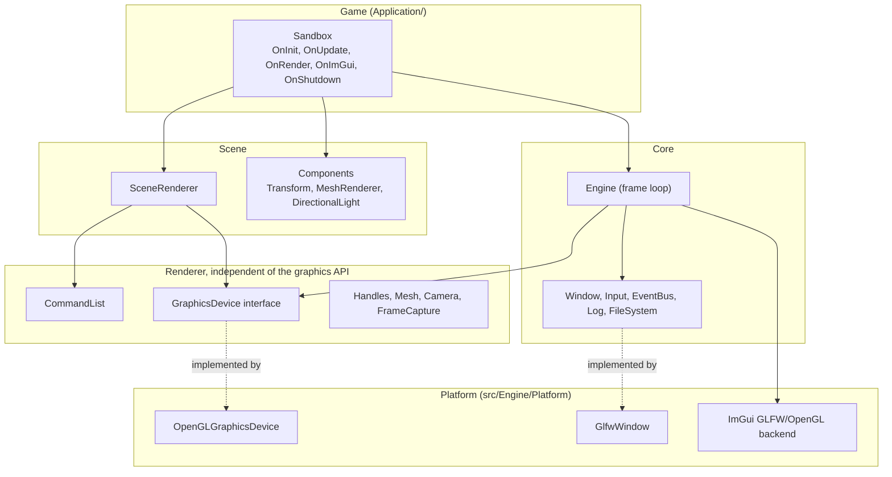
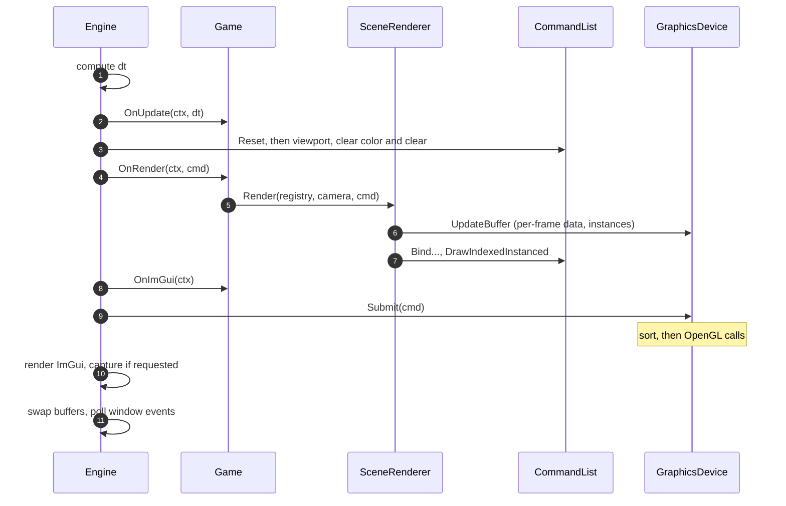

# GEF architecture

This document explains how GEF is organized and what happens during a frame. It describes
v0.1.0. The first part gives the overall picture and a short tour of every module; the second
part goes into the pieces that shape the renderer.

1. [Overview](#overview)
2. [Tour of the modules](#tour-of-the-modules)
3. [The engine and the game](#the-engine-and-the-game)
4. [A frame from start to finish](#a-frame-from-start-to-finish)
5. [GPU resources and handles](#gpu-resources-and-handles)
6. [The command list](#the-command-list)
7. [Submitting a frame](#submitting-a-frame)
8. [From entities to instanced draws](#from-entities-to-instanced-draws)
9. [Lighting](#lighting)
10. [Frame capture](#frame-capture)
11. [Rules the code relies on](#rules-the-code-relies-on)
12. [Known limits](#known-limits)

## Overview

GEF is a static library (`GEF::Engine`) that a game links against. The game keeps its world in a
libecs registry: entities with a `Transform`, a `MeshRenderer` (which mesh, which material) and
one `DirectionalLight`. The engine runs the loop, and on each frame:

1. the game updates its entities (input, movement, gameplay);
2. the scene renderer reads the entities and records draw commands into a command list;
3. the graphics device sorts the commands and turns them into OpenGL calls.

The code is split in layers. Each layer only uses the ones below it:



The public headers are in `Engine/include/Engine/` and never include OpenGL, glad or GLFW. All
the code that calls those APIs lives in `Engine/src/Engine/Platform/`, behind interfaces
(`Window`, `GraphicsDevice`, `ImGuiBackend`) whose implementation is picked at startup. A game
written against GEF does not depend on OpenGL.

## Tour of the modules

**Core** (`Engine/Core/`)

- `Engine` owns the window, the graphics device and the ImGui backend, and runs the frame loop.
  It is described [below](#the-engine-and-the-game).
- `Window` is an interface; `GlfwWindow` implements it. It creates the OpenGL context, translates
  GLFW callbacks into engine events, and handles VSync, cursor mode and window mode.
- `Input` is read by polling: once per frame it copies the state of every key and mouse button,
  and keeps the previous frame's state, which gives `IsKeyPressed`, `IsKeyJustPressed`,
  `IsKeyJustReleased` and the mouse delta.
- `EventBus` delivers window events (resize, close, keys) to subscribers. `Subscribe` returns an
  id used to `Unsubscribe`.
- `Log` wraps two spdlog loggers, one for the engine and one for the game, behind macros
  (`GEF_ENGINE_INFO`, `GEF_ERROR`, ...). `Assert` provides `GEF_CORE_ASSERT`, active in Debug only.
- `FileSystem` finds the executable's directory and the `assets/` folder next to it, and reads
  text files.

**Renderer** (`Engine/Renderer/`)

- `GraphicsDevice` is the interface to the GPU: create and destroy buffers, vertex arrays, shaders
  and pipelines, update buffers, submit a command list, read the framebuffer back.
- `Handle` is the type the device hands out for each resource
  ([details](#gpu-resources-and-handles)).
- `CommandList` records the frame's draws ([details](#the-command-list)).
- `Mesh` holds the vertex format (`Vertex`: position, normal, UV), the per-instance format
  (`InstanceData`), and `UploadMesh` / `DestroyMesh`, which turn CPU-side `MeshData` into GPU
  buffers and back.
- `Camera` is a perspective camera defined by a position, yaw and pitch. It computes the view and
  projection matrices.
- `LightingData` holds the C++ copies of the shader uniform blocks.
- `FrameCapture` saves screenshots and frame sequences ([details](#frame-capture)).

**Scene** (`Engine/Scene/`): the ECS components and the `SceneRenderer`, which turns them into
draws ([details](#from-entities-to-instanced-draws)).

**Assets** (`Engine/Assets/`): `LoadObj` reads an OBJ file with tinyobjloader and returns
`MeshData`, merging identical vertices so they are shared by the index buffer.

**UI** (`Engine/UI/`): `ImGuiBackend` sets up Dear ImGui for the window and the graphics API. The
game draws its own windows with the ImGui API in `OnImGui`.

**Utils** (`Engine/Utils/`): `FrameTimer` collects the frame times and, every second, computes
their statistics (mean, median, p95, p99, worst) with `FrameStatistics`; the benchmark uses the same
code. `Overloaded` is the usual helper for `std::visit`.

**Platform** (`src/Engine/Platform/`): the implementations. `OpenGLGraphicsDevice` and
`OpenGLContext` (which loads OpenGL with glad, checks for version 4.5, and in Debug forwards the
driver's debug messages to the log), `GlfwWindow`, and the ImGui backend for GLFW and OpenGL.

## The engine and the game

There is no base class to inherit from and no global instance. The game's `main` creates both
the engine and the game, and starts the loop:

```cpp
int main()
{
    GEF::Engine engine({ .title = "Sandbox" });
    Sandbox game;
    return engine.Run(game);
}
```

`Run` is a template constrained by the `GEF::Game` concept: the type needs
`OnUpdate(EngineContext&, float dt)` and `OnRender(EngineContext&, CommandList&)`. `OnInit`,
`OnImGui` and `OnShutdown` are optional; `Run` checks for them at compile time with
`if constexpr (requires { ... })`. Since the game's type is known at compile time, there is no
virtual call in the loop.

The game never receives the engine itself. Every callback gets an `EngineContext`, a struct of
references to what a game may use: the window, the input, the graphics device, the event bus and
the frame capture. To give games access to a new engine service, a field is added to that struct.

Ownership is kept simple:

| What                                   | Owned by            | Lives until                                                                   |
|----------------------------------------|---------------------|-------------------------------------------------------------------------------|
| Window, graphics device, ImGui backend | `Engine`            | the engine is destroyed (the window last, since the device needs its context) |
| The frame's `CommandList`              | `Engine`            | the end of the run; it is reset every frame but keeps its memory              |
| GPU objects                            | `GraphicsDevice`    | the game calls `Destroy*` on the handle                                       |
| `SceneRenderer`, meshes, shaders       | the game            | usually created in `OnInit`, destroyed in `OnShutdown`                        |
| Entities and components                | the game's registry | the game destroys them                                                        |

## A frame from start to finish



Window events are produced while polling, at the end of the frame. The engine handles the ones
that concern it first (close stops the loop, resize updates the viewport size), then passes every
event to the event bus, where the game may have subscribed. The demo subscribes to resize to keep
the camera's aspect ratio right.

## GPU resources and handles

The game never holds an OpenGL id or a pointer to a GPU object. When it creates a resource, the
device stores the object and returns a handle:

```cpp
template <typename Tag>
struct Handle { uint32_t index; uint32_t generation; };

using BufferHandle = Handle<BufferTag>;   // also VertexArrayHandle, ShaderHandle, PipelineHandle...
```

The tag only makes each handle a distinct type, so a buffer handle cannot be passed where a
pipeline is expected.

On the device side, each kind of resource is kept in a `ResourcePool`: an array of slots plus a
list of free slots. `index` is the slot. `generation` counts how many times that slot was reused:
destroying a resource increments it. A handle to a destroyed resource therefore no longer matches
its slot, even after a new resource took the place. Using it triggers an assert in Debug and
returns nothing in Release, instead of quietly using the wrong object.

This is the main difference with a design where each resource is a C++ object holding its
OpenGL id and freeing it in its destructor:

- the device decides when GPU objects are freed, which is always at a known point, with a valid
  context;
- handles are 8 bytes and can be copied, compared and hashed, which the command list and the
  scene renderer rely on;
- the API does not mention OpenGL anywhere.

Resources are described with plain structs: `BufferDesc` (type, usage, size, initial data),
`VertexArrayDesc` (vertex buffers with their layout and instance divisor, index buffer),
`ShaderDesc` (sources), `PipelineDesc` (shader, depth test and write, face culling). The OpenGL
device uses Direct State Access (`glCreateBuffers`, `glNamedBufferSubData`,
`glVertexArrayAttribFormat`, ...), which modifies objects directly instead of binding them first.

## The command list

A naive renderer calls OpenGL as soon as the game asks for something. The order of the calls is
then the order in which the game happens to draw, and every draw re-binds its shader, its mesh and
its uniforms even when they did not change.

GEF records first and executes later. While recording, the `CommandList` only stores data:

```cpp
cmd.BindPipeline(pipeline);            // remembered as the current pipeline
cmd.BindVertexArray(mesh.vertexArray); // remembered as the current mesh
cmd.BindUniformBuffer(UniformBinding::Frame, frameBuffer);
cmd.DrawIndexedInstanced(indexCount, instanceCount, firstInstance);
```

`Bind*` calls only update the list's current state. Each draw copies that state into a
`DrawPacket`: pipeline, vertex array, the uniform buffer of each binding, and the draw's
parameters. A packet does not depend on what was recorded before it, so packets can be executed
in any order.

Each packet also gets a 64-bit sort key. Sorting the keys puts the packets in the order that
minimizes state changes:

| Bits  | 63 to 60 | 59 to 48 | 47 to 36     | 35 to 20 | 19 to 0  |
|-------|----------|----------|--------------|----------|----------|
| Field | pass     | pipeline | vertex array | depth    | sequence |

- The most expensive change, the pipeline, is in the high bits, so all draws with the same
  pipeline end up together, then grouped by mesh inside it.
- The sequence is the packet's position in the recording. Every key is different, so the sort
  gives the same result on every run, and the key also says which packet it belongs to. Only the
  keys are sorted, the packets stay where they are.
- The pass and depth fields are not used yet (always 0). They are reserved for separating opaque
  and transparent objects and for ordering by distance.
- The field sizes set the limits: 4096 pipelines, 4096 vertex arrays, about a million draws per
  frame. They are checked by asserts.

Viewport, clear color and clear are frame-level commands. They are kept in a separate list and
executed in order, before the draws.

The command list is reused from one frame to the next. `Reset` empties it without releasing its
memory, so once the biggest frame has been seen, recording does not allocate anymore.

## Submitting a frame

`OpenGLGraphicsDevice::Submit` sorts the keys, runs the frame commands, then goes through the
packets in sorted order. It remembers what is currently bound (pipeline, vertex array, uniform
buffer of each binding) and only calls OpenGL for what differs from the previous packet. Binding
a pipeline sets the shader program and its depth and culling state. Then it issues the draw with
`glDrawElementsInstancedBaseInstance`.

What is currently bound is forgotten at the start of every `Submit`. ImGui renders between two
frames and changes OpenGL state without going through the device, so trusting the previous
frame's state would skip binds that are needed.

The device counts what it really did in `SubmitStats`: draw calls, pipeline changes, vertex array
changes and uniform buffer changes. The demo's overlay and the benchmark read them with
`GetLastSubmitStats()`.

Buffer updates are the exception to "record first": `UpdateBuffer` writes immediately. This works
because each buffer is written once per frame, before `Submit` (see the
[rules](#rules-the-code-relies-on)).

## From entities to instanced draws

The components are plain structs:

| Component          | Content                                                                                   |
|--------------------|-------------------------------------------------------------------------------------------|
| `Transform`        | position, rotation (quaternion), scale                                                    |
| `MeshRenderer`     | a `Mesh` (handles and index count) and a `Material` (color, shininess, specular strength) |
| `DirectionalLight` | direction, color, intensity, ambient color                                                |

`SceneRenderer::Render(registry, camera, cmd)` does the following each frame:

1. It writes two uniform buffers that are the same for every object: the frame data (camera
   matrices and position, binding 0) and the light (binding 1).
2. It goes through every entity that has a `Transform` and a `MeshRenderer`, and adds an
   `InstanceData` to the batch of its mesh: model matrix, normal matrix, color and specular
   values. Batches are found by the mesh's vertex array handle.
3. For each batch, it uploads the instances to the batch's instance buffer (doubling its size
   when it is too small) and records the draw.

Instancing means drawing the same mesh several times with one call, each copy reading its own
data. The batch's vertex array combines two buffers: the mesh's vertices, read once per vertex,
and the instance buffer, read once per instance (divisor 1). The vertex shader receives the
position, normal and UV of the vertex, and the model matrix, normal matrix and material of the
instance it belongs to.

With instancing on, a batch is one draw of `count` instances. With it off, the renderer records
`count` draws of one instance each, starting at instance `i`. Both use the same data and the same
shader, which is why the demo's toggle and the benchmark measure the cost of draw calls alone.

## Lighting

The lit shader (`lit.vert`, `lit.frag`, embedded in the library from `Engine/embed/shaders`) uses the Blinn-Phong model
with one directional light:
an ambient term, a diffuse term proportional to the angle between the surface and the light, and
a specular highlight whose size depends on the shininess. Colors are picked in sRGB, converted to
linear on the CPU, lit in linear space, then gamma corrected by the shader before being written.

The uniform blocks use the `std140` layout. Their C++ copies in `LightingData.hpp` only use
`vec4` and `mat4`, which have the same layout in C++ and in GLSL, and their sizes are checked with
`static_assert`.

## Frame capture

The game can ask for a screenshot or a sequence of frames through `ctx.capture`.
`RequestScreenshot` saves the next frame to `screenshots/<timestamp>.png`, and
`RequestSequence(n)` saves the next `n` frames to `screenshots/<timestamp>/frame_0000.png` and
following, ready for ffmpeg.

At the end of the frame, after ImGui and before the swap, the engine calls the capture, which
reads the image back with `GraphicsDevice::ReadFramebuffer`. OpenGL stores images from the
bottom row up, so the rows are flipped before the PNG is written with stb_image_write.

During a sequence, the frames are kept in memory and written at the end, and the engine gives
the game a fixed `dt` of 1/30 s. Reading back and saving frames is slow and irregular; with a
fixed step, each saved frame is exactly 1/30 s after the previous one, and the GIF plays at the
right speed.

## Rules the code relies on

1. **Only the graphics device calls OpenGL**, apart from the ImGui backend. The game and the scene
   renderer use handles and record commands.
2. **A draw packet is self-contained.** This is what allows sorting.
3. **A buffer is written at most once per frame, before `Submit`.** `UpdateBuffer` is
   immediate, so a second write in the same frame would replace the data for every draw of that
   frame.
4. **The bound-state cache only lives during one `Submit`.**
5. **Handles are checked when used**, and a stale handle asserts in Debug.
6. **One command list per frame.** The engine resets it at the start of the frame and submits it
   at the end.

## Known limits

These come from the current design and are the starting points of the
[roadmap](../README.md#roadmap):

- Because buffer updates are immediate, one buffer cannot hold different values for different
  draws of the same frame. A ring buffer for per-frame data, or recorded updates, would lift this.
- Recording happens on one thread. Since packets are self-contained, several threads could each
  fill a list and the lists could be merged before sorting.
- The scene renderer uploads every instance every frame, around 6 MB per frame at 50,000
  entities, even if nothing moved.
- There is a single pass. Shadow maps or post-processing need render targets and several passes
  in a known order, which is what a render graph would organize.
- There is one backend. The interfaces were written with a second one in mind, but nothing has
  tested them yet.
